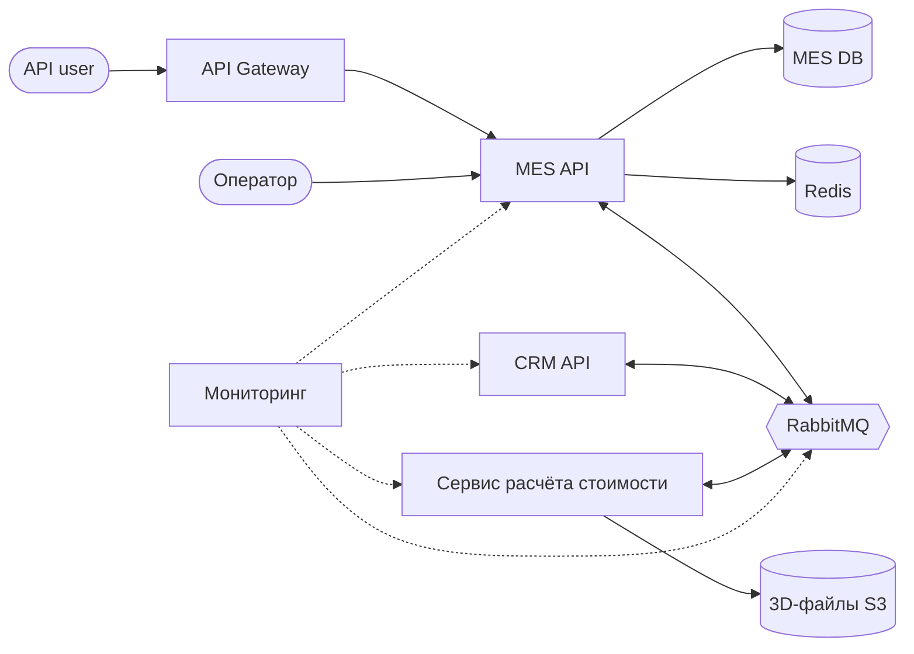

# Планирование: анализ, идентификация проблем и поиск решений

## 1. Проблемы

| № | Проблема | К чему приводит |
|---|---|---|
| П1 | Расчёт стоимости (2–30 минут) выполняется прямо в MES API, у которого всего один инстанс. | Очередь на расчёт растёт, заказы долго ждут цену, MES тормозит. |
| П2 | Расчёт, скорее всего, синхронный: клиент ждёт ответа HTTP-запроса десятки минут. | Таймауты, результат расчёта теряется, и заказ не создаётся в CRM. |
| П3 | Нет гарантий доставки сообщений через RabbitMQ (подтверждений, повторов, очереди ошибок). | Сообщения о заказах теряются, заказы «зависают» между CRM и MES. |
| П4 | Нет мониторинга и алертов. | О проблемах узнаём из жалоб клиентов. |
| П5 | Медленный дашборд MES. Вероятные причины: нет индексов, OFFSET-пагинация, нет кэша, одна БД на чтение и запись. | Операторы поздно видят новые заказы. |
| П6 | Внешний API без ограничений на количество запросов. | Поток заказов от партнёров перегружает систему для всех. |
| П7 | У каждого приложения и каждой БД по одному инстансу. | Отказ одного сервера останавливает приложение, масштабироваться нельзя. |
| П8 | CRM пишет напрямую в БД магазина. | Сильная связанность приложений, данные в системах могут расходиться. |
| П9 | E2E-тесты ручные, релизы задерживаются больше чем на месяц. | Исправления долго доходят до продакшна. |
| П10 | Один C#-разработчик на MES, самую проблемную систему. | Вся работа над MES зависит от одного человека. |

## 2. Инициативы

| № | Инициатива | Решает |
|---|---|---|
| И1 | **Мониторинг и алерты:** Prometheus и Grafana, метрики по статусам заказов и очередям, алерт «заказ застрял в статусе». | П4 |
| И2 | **Надёжные сообщения в RabbitMQ:** подтверждения (ack), повторы, очередь ошибок (DLQ), защита от повторной обработки. | П3 |
| И3 | **Асинхронный расчёт стоимости:** выносим расчёт в отдельный сервис, задачи приходят через очередь, количество воркеров можно увеличивать. | П1, П2 |
| И4 | **Ускорение дашборда MES:** индексы по статусу и дате, keyset-пагинация, кэш в Redis. | П5 |
| И5 | **API Gateway с rate limiting** для внешних партнёров. | П6 |
| И6 | **Несколько инстансов** приложений за балансировщиком, read-реплика БД. | П7 |
| И7 | **Автотесты и автоматический деплой**, найм C#-разработчика. | П9, П10 |
| И8 | **Убрать прямой доступ CRM к БД магазина:** заменить его на API или события. | П8 |

## 3. Приоритеты

Логика простая: сначала **увидеть** проблему, потом **перестать терять заказы**, потом **убрать главное узкое место**.

1. **И1. Мониторинг.** Без него причины проблем остаются догадками. Делается быстро.
2. **И2. Надёжные сообщения.** Потерянное сообщение — это потерянный заказ. Изменения небольшие.
3. **И3. Асинхронный расчёт.** Главная причина задержек, но и самая трудоёмкая задача.
4. **И4. Дашборд MES.** Частично ускорится сам, когда расчёт уйдёт из MES API.
5. **И5. API Gateway.** Защищает от всплесков нагрузки со стороны партнёров.
6. **И7. Автотесты и найм.** Найм стоит начать сразу, параллельно с остальными задачами.
7. **И6. Масштабирование.** Понадобится при дальнейшем росте нагрузки.
8. **И8. Разделение БД.** Большой рефакторинг, делать после того, как система стабилизирована.

## 4. Целевая архитектура через полгода

- Расчёт стоимости работает в отдельном сервисе, задачи приходят через очередь.
- Сообщения между системами не теряются.
- Есть мониторинг и алерты.
- Дашборд MES работает быстро за счёт индексов и кэша.
- Партнёры обращаются к системе через API Gateway.

## 5. Если можно выполнить только три инициативы

1. **И1. Мониторинг.** Покажет, где на самом деле застревают заказы, и поможет проверить, сработали ли остальные изменения.
2. **И2. Надёжные сообщения.** Напрямую решает жалобы «не получили заказ».
3. **И3. Асинхронный расчёт.** Убирает главное узкое место системы и разгружает MES API, поэтому дашборд тоже станет быстрее.
