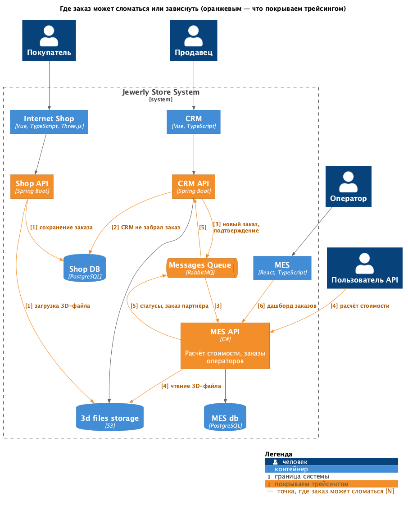
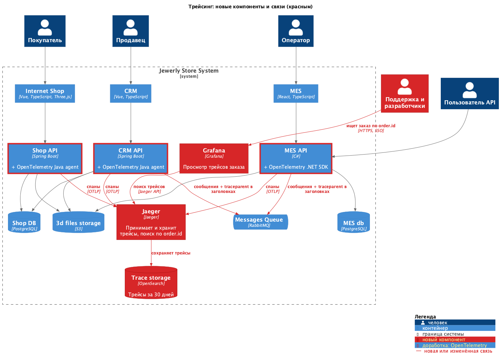
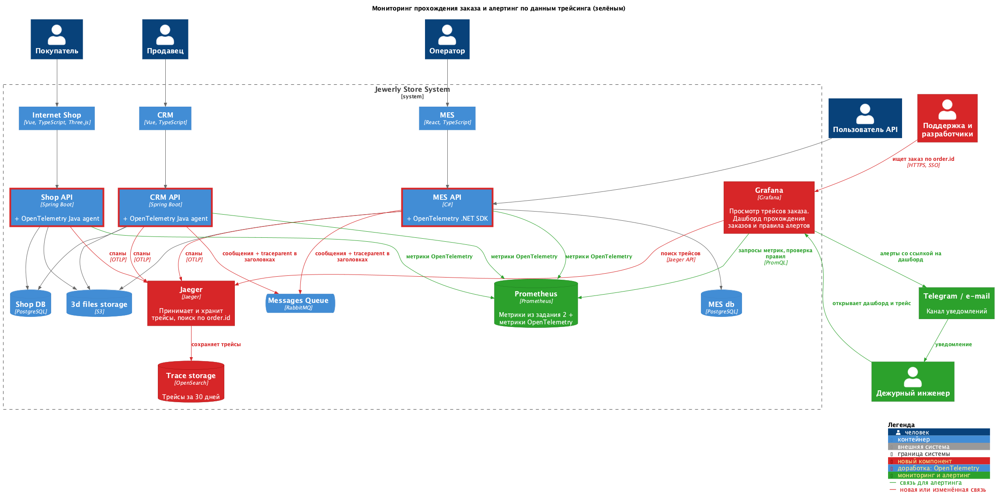

# Архитектурное решение по трейсингу

## Где заказ может сломаться или зависнуть

| № | Место | Что может случиться |
|---|---|---|
| 1 | Shop API → Shop DB, S3 | Не сохранился заказ или 3D-файл (статусы FILE_UPLOADED, SUBMITTED). |
| 2 | CRM API → Shop DB | CRM не забрал новый заказ из БД магазина. |
| 3 | CRM API → RabbitMQ → MES API | Сообщение о новом заказе или подтверждении (MANUFACTURING_APPROVED) потерялось или не обработалось. |
| 4 | MES API: расчёт стоимости | Расчёт идёт 2–30 минут на единственном инстансе: зависает, падает, у партнёра истекает таймаут. |
| 5 | MES API → RabbitMQ → CRM API | Потерялось сообщение о смене статуса или о заказе партнёра, и CRM о нём не знает. |
| 6 | MES → MES API: дашборд | Дашборд медленно грузится, оператор поздно видит заказ, и MANUFACTURING_STARTED откладывается. |

Трейсингом покрываем **Shop API, CRM API, MES API и RabbitMQ** (через заголовки сообщений). Вызовы БД и S3 попадут в трейсы автоматически как дочерние спаны.

## Данные в трейсинге

- `trace_id`, `span_id`, сервис, операция, время начала и длительность.
- `order.id`, статус заказа до и после операции, источник заказа (B2C / партнёр), `partner_id`.
- Для RabbitMQ: очередь, `message_id`, отправка или получение, номер повторной попытки.
- Для расчёта стоимости: размер файла и число полигонов 3D-модели.
- Ошибки: статус спана, тип и текст ошибки.
- Персональные данные клиентов (ФИО, телефон, адрес) и содержимое файлов в трейсинг **не попадают**.

## Мотивация

Сейчас никто не может сказать, где находится заказ и почему он завис: каждое приложение видит только свою часть пути, а потерянное сообщение RabbitMQ не оставляет следов. Трейсинг покажет путь заказа через все системы: поддержка по номеру заказа за минуты найдёт, на каком шаге он остановился и с какой ошибкой. Это вернёт доверие клиентов и партнёров, которых компания уже начала терять.

На какие метрики повлияет:

| Метрика | Ожидаемый эффект |
|---|---|
| Время поиска причины проблемы с заказом | С дней до минут. |
| Число потерянных заказов (сообщений без обработки) | Каждая потеря видна, причины устраняются, число стремится к нулю. |
| Доля заказов, выполненных дольше обещанных трёх недель | Снижается, потому что зависшие заказы находятся вовремя. |
| Число жалоб клиентов и партнёров, потерянные контракты | Снижается. |

## Предлагаемое решение

- **OpenTelemetry** — открытый стандарт трейсинга, поддерживает Java и C#:
  - Shop API и CRM API: подключаем OpenTelemetry Java agent, код почти не меняется;
  - MES API: подключаем OpenTelemetry .NET SDK, у нас есть исходный код MES;
  - в каждый спан добавляем атрибут `order.id`.
- **Передача контекста через RabbitMQ:** при отправке сообщения кладём заголовок `traceparent`, при получении продолжаем тот же трейс. Так видно, какое сообщение отправили, но не получили.
- **Jaeger** принимает спаны напрямую от сервисов по протоколу OTLP и хранит их в OpenSearch 30 дней. Поиск по тегу `order.id` показывает все шаги заказа, даже если они растянулись на несколько недель и разные трейсы.
- **Grafana** (уже выбрана в задании 2) — интерфейс для поиска и просмотра трейсов из Jaeger. Собственный интерфейс Jaeger наружу не открываем: в нём нет входа по учётной записи.

[Схема: трейсинг (новые элементы — красным)](diagrams/2-tracing-solution.png)

### Мониторинг прохождения заказа и алертинг

- **Метрики:** те же библиотеки OpenTelemetry, которые создают спаны, считают по тем же операциям количество, ошибки и длительность. Prometheus забирает эти метрики из сервисов. `order.id` в метрики не попадает, чтобы не было отдельного графика на каждый заказ.
- **Дашборд в Grafana:** сколько заказов прошло каждый шаг, время между шагами, ошибки по сервисам.
- **Алерты** (Grafana Alerting → Telegram и e-mail дежурному инженеру):
  - есть спаны с ошибкой при смене статуса заказа;
  - сообщений в очередь отправлено больше, чем получено, и разница держится дольше 10 минут: сообщения теряются;
  - расчёт стоимости идёт дольше 30 минут;
  - время перехода между статусами выше нормы (например, от SUBMITTED до PRICE_CALCULATED дольше часа).
- В алерте есть ссылка на дашборд, а с него можно перейти к трейсам с ошибкой и увидеть конкретный заказ.

[Схема: мониторинг и алертинг (новые элементы — зелёным)](diagrams/3-tracing-alerting.png)

## Компромиссы

- **Ручные шаги и производство не видны в трейсах.** Подтверждение продавцом, работа оператора и доставка видны только как смена статуса, а не как непрерывный трейс.
- **CRM читает заказы прямо из БД магазина.** Контекст трейса через БД не передаётся, поэтому шаги связываются только по `order.id`, пока не будет сделана инициатива И8 из задания 1.
- **Доработка MES дорогая:** C#-разработчик один, и он нужен для других задач. Если не хватит времени, сначала покрываем только приём и отправку сообщений RabbitMQ и расчёт стоимости.
- **Фронтенды (Vue, React) не покрываем:** польза мала, а работы много.
- **Затраты на хранение.** Заказов немного, поэтому их трейсы храним все. Частые технические запросы (дашборд, health-check) сохраняем выборочно (сэмплирование).

## Безопасность

- **Вход только через корпоративную учётную запись (SSO).** Трейсы видят сотрудники с ролью «Поддержка» или «Разработчик», настраивать систему может только DevOps.
- **Закрытая сеть:** Jaeger, OpenSearch и Prometheus недоступны из интернета. Отправлять спаны в Jaeger могут только наши сервисы, это ограничено правилами группы безопасности и TLS.
- **Нет персональных данных:** в спаны добавляем только атрибуты из утверждённого списка, на код-ревью проверяем, что персональных данных там нет.
- **Партнёры не имеют доступа к трейсингу.** Заголовок `traceparent` из внешних запросов не используем, трейс начинается заново.
- **Хранилище трейсов зашифровано**, данные удаляются через 30 дней, действия пользователей Grafana записываются в журнал аудита.
