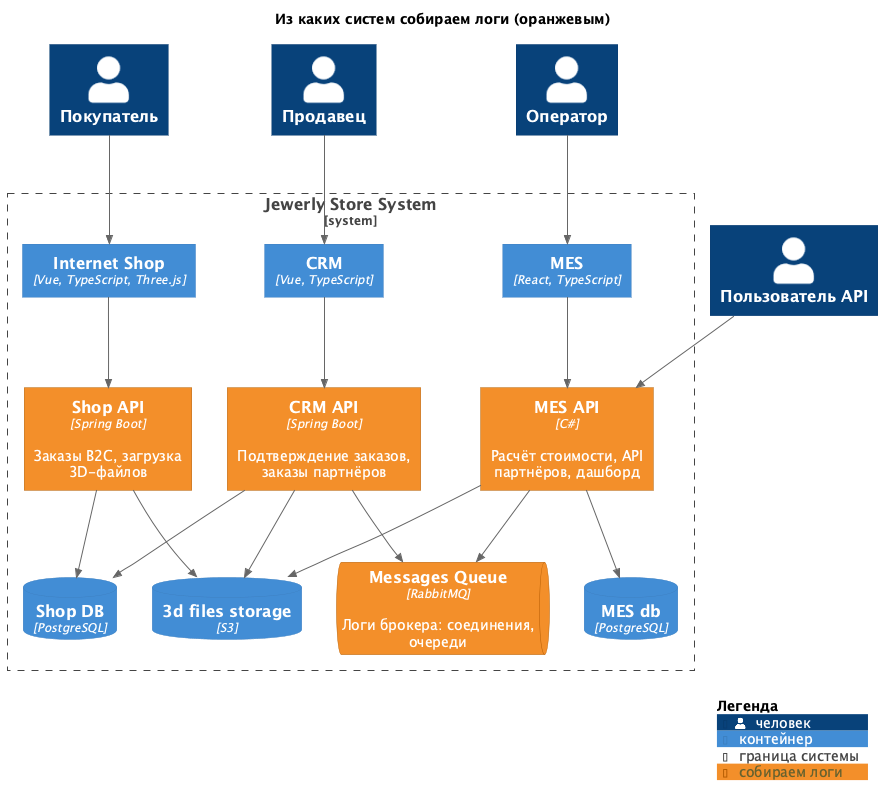
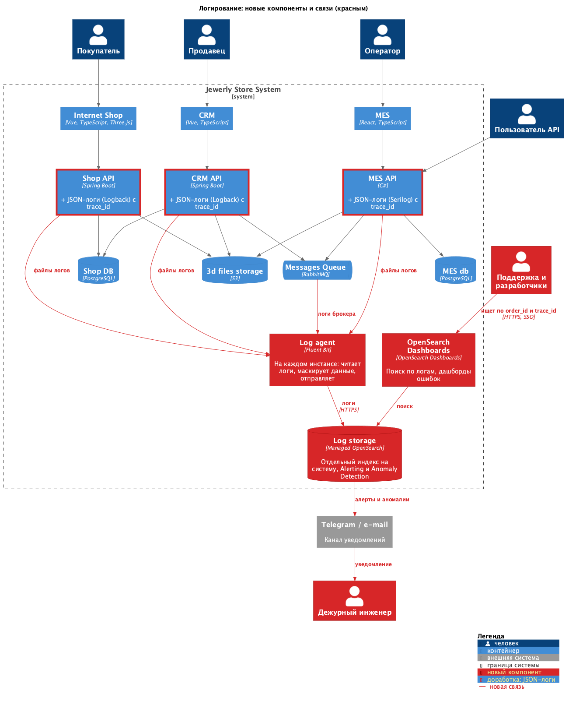

# Архитектурное решение по логированию

## Какие логи собираем

Логи собираем из **Shop API, CRM API, MES API и RabbitMQ**: здесь создаются заказы, меняются статусы и теряются сообщения. Фронтенды, управляемые БД и S3 в общую систему не собираем: польза мала, а логи БД при необходимости можно посмотреть в консоли Yandex Cloud.

В каждой записи есть общие поля: время, уровень, сервис, окружение, `trace_id` (связь с трейсингом из задания 3).

### Логи уровня INFO

| Событие | Где | Что логируем |
|---|---|---|
| Создание заказа | Shop API, CRM API (заказ партнёра) | Номер заказа, `customer_id` или `partner_id`, источник (B2C / партнёр). |
| Изменение статуса заказа | Shop API, CRM API, MES API | Номер заказа, `customer_id` или `partner_id`, старый и новый статус. |
| Загрузка 3D-файла | Shop API | Номер заказа, размер файла, ключ в S3. |
| Начало и окончание расчёта стоимости | MES API | Номер заказа, число полигонов, длительность, результат. |
| Запрос партнёра к API | MES API | `partner_id`, метод, код ответа, длительность. |
| Отправка и получение сообщения | CRM API, MES API | Очередь, `message_id`, номер заказа, тип события. |
| Действие сотрудника с заказом | CRM API, MES API | `user_id` продавца или оператора, номер заказа, действие (подтвердил, взял в работу). |
| Запуск и остановка приложения | Все сервисы | Версия релиза. |

### Другие уровни

- **ERROR** — операция не выполнена: исключение, ошибка расчёта, сообщение ушло в очередь ошибок (DLQ), ошибка БД или S3. Пишется всегда.
- **WARN** — проблема, которую система пока обходит сама: повторная обработка сообщения, расчёт дольше 30 минут, медленный запрос дашборда, ошибки валидации запросов партнёров (4xx).
- **DEBUG** — только в dev и release. В prod включаем временно для одного сервиса на время разбора проблемы.
- **TRACE** не используем.

## Мотивация

Сейчас проблемы разбираются со слов клиента, а разработчики часами восстанавливают, что произошло. Логи в одном месте с поиском по номеру заказа позволят поддержке самой увидеть, что случилось и с какой ошибкой, без привлечения разработчиков. Вместе с трейсингом это даёт полную картину: трейс показывает, где остановился заказ, а логи — почему.

| Метрика | Ожидаемый эффект |
|---|---|
| Время разбора обращения (MTTR) | С дней до часов и минут. |
| Доля обращений, переданных разработчикам | Снижается: поддержка находит причину сама. |
| Доля проблем, найденных до жалобы клиента | Растёт за счёт алертов по ошибкам. |
| Число просроченных заказов и жалоб партнёров | Снижается: причины зависаний находятся и устраняются. |

### Порядок внедрения логирования и трейсинга

1. **MES API и обмен сообщениями через RabbitMQ** (в MES API и CRM API) — здесь зависает расчёт, теряются заказы и работают партнёры, которые больше всех жалуются.
2. **CRM API** — создаёт заказы партнёров и подтверждает заказы.
3. **Shop API** — путь B2C-заказа короче, жалоб меньше.

В каждой системе сначала включаем логи (это настройка логгера), потом трейсинг — он требует больше работы.

## Предлагаемое решение

- **Структурированные JSON-логи в сервисах:** в Shop API и CRM API — Logback с JSON-форматом, в MES API — Serilog. `trace_id` добавляется автоматически из OpenTelemetry.
- **Fluent Bit** — агент на каждом инстансе (включая RabbitMQ): читает файлы логов, маскирует чувствительные данные, отправляет в хранилище.
- **Yandex Managed Service for OpenSearch** — хранилище логов. В нём же работают плагины Alerting и Anomaly Detection.
- **OpenSearch Dashboards** — поиск по номеру заказа и `trace_id`, дашборды ошибок по сервисам.

[Схема: логирование (новые элементы — красным)](diagrams/2-logging-solution.png)

### Безопасность

- **Чувствительные данные в логи не пишем:** ФИО, телефон, адрес, e-mail, платёжные данные, содержимое 3D-файлов, пароли, токены и ключи API. Покупатель указывается только как `customer_id`.
- **Двойная защита:** правило проверяется на код-ревью, а Fluent Bit дополнительно маскирует по шаблонам телефоны, e-mail и номера карт.
- **Доступ через корпоративную учётную запись (SSO) и роли:** поддержка читает логи prod, разработчики — логи всех окружений, DevOps администрирует систему. Удалять и менять логи не может никто из пользователей. Партнёры доступа не имеют.
- **Закрытая сеть и шифрование:** OpenSearch недоступен из интернета, агенты пишут логи по TLS под отдельной учётной записью только с правом записи. Хранилище зашифровано, действия пользователей записываются в журнал аудита.

### Хранение

Для каждой системы — отдельный индекс, новый каждый день (например, `logs-mes-api-2026.10.11`). Так у систем разные сроки хранения и права доступа, а «шумный» сервис не мешает искать по другим. Старые индексы удаляет политика Index State Management.

| Индекс | Срок хранения | Объём |
|---|---|---|
| `logs-mes-api-*` | 30 дней | Самый большой: запросы партнёров и дашборд операторов. |
| `logs-shop-api-*`, `logs-crm-api-*` | 30 дней | Средний. |
| `logs-rabbitmq-*` | 14 дней | Небольшой. |
| `logs-audit-orders-*` — смены статусов и действия сотрудников | 1 год (разбор споров с клиентами и партнёрами) | Небольшой: несколько записей на заказ. |
| DEBUG-логи любого сервиса | 3 дня | Только на время разбора проблемы. |

Точный объём измеряем после запуска и увеличиваем диск вместе с ростом числа заказов.

## Анализ логов

**Алертинг нужен.** Плагин Alerting отправляет уведомления в Telegram и на e-mail дежурному инженеру (тот же канал, что в задании 3):

- резкий рост числа ERROR в сервисе;
- сообщение ушло в DLQ или ошибка расчёта стоимости — сразу;
- сервис перестал писать логи — упал сервис или агент;
- много ошибок 4xx от одного партнёра — проблема с интеграцией, сообщаем менеджеру партнёра.

**Поиск аномалий нужен.** Плагин Anomaly Detection сам учит обычный уровень и сообщает об отклонениях:

- число созданных заказов в минуту (всего и по `partner_id`): резкий рост — возможная атака или зацикленная интеграция партнёра, падение до нуля — сломан приём заказов;
- число запросов к API от одного партнёра или IP-адреса — повод ограничить его через API Gateway (инициатива И5);
- число ERROR и WARN по сервисам — рост ошибок после релиза.

## Выбор технологии

| Критерий | ELK | OpenSearch | Splunk | Grafana Loki |
|---|---|---|---|---|
| Лицензия | Elastic License / SSPL / AGPL | Apache 2.0 | Проприетарная | AGPL |
| Стоимость | Бесплатно, SSO и поиск аномалий — в платной подписке | Бесплатно, всё включено | Дорого, оплата за объём данных | Бесплатно |
| Доступность в России | Продажи и поддержка прекращены | Доступен | Ушёл из России | Доступен |
| Managed-сервис в Yandex Cloud | Нет (снят, заменён на OpenSearch) | Есть | Нет | Нет |
| Полнотекстовый поиск | Да | Да | Да | Только по меткам, текст ищется перебором |
| Алертинг и поиск аномалий | Есть, аномалии платно | Есть, бесплатно | Есть | Алерты через Grafana, аномалий нет |
| Связь с нашим стеком | Нет | Уже хранит трейсы (задание 3) | Нет | Встроен в Grafana |
| Требования к ресурсам | Высокие | Высокие | Высокие | Низкие, хранит в S3 |

**Выбор — OpenSearch.** Плюсы: бесплатный, есть managed-сервис в Yandex Cloud, поэтому DevOps-инженеру не нужно его администрировать, алертинг, поиск аномалий и SSO включены бесплатно, используем тот же стек, что для трейсов. Минусы: требует много памяти и диска, интерфейс менее удобен, чем Kibana. Loki дешевле, но в нём нет поиска аномалий и быстрого поиска по тексту ошибок.
