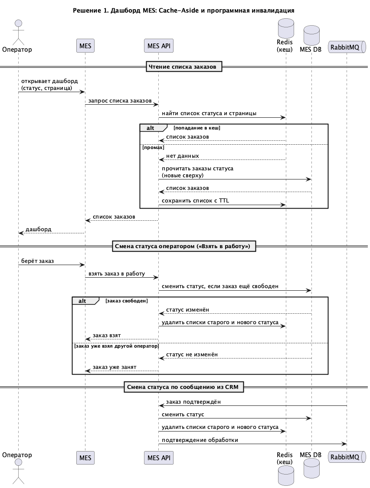
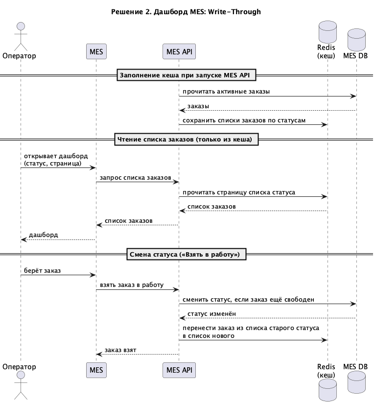

# Архитектурное решение по кешированию

## Мотивация

**Какие проблемы решаем:**

- **Медленный дашборд MES.** Каждый оператор постоянно открывает и обновляет список заказов, и каждый раз MES API делает одинаковый запрос к единственному инстансу MES DB. Эта же БД обслуживает расчёт стоимости и запросы партнёров. Фильтр и пагинация не помогли: запросы всё равно идут в нагруженную БД. Операторы поздно видят новые заказы, теряют вознаграждение, и заказы позже уходят в производство.
- **Долгое ожидание цены.** Расчёт стоимости занимает 2–30 минут, при этом партнёры и покупатели часто заказывают одинаковые изделия: модели из каталога партнёра, комбинации готовых элементов конструктора. Одну и ту же модель MES считает заново.

**Что включаем в кеширование:**

| Элемент | Почему |
|---|---|
| Список заказов дашборда MES (по статусу и странице) | Одинаков для всех операторов, читается гораздо чаще, чем меняется. |
| Результат расчёта стоимости | Считается долго, для одной и той же модели и материала результат одинаков. |

Кеш разгрузит MES DB и MES API, дашборд будет открываться быстрее, а цена для уже знакомой модели будет готова сразу. Потерю сообщений и долгий расчёт новых моделей кеш не решает — для этого нужны инициативы И2 и И3 из задания 1.

## Предлагаемое решение

### Серверное кеширование

Выбираем **серверное кеширование** в Redis (managed-сервис в Yandex Cloud), к которому обращается MES API.

Клиентский кеш здесь не подходит: он помогает только одному оператору и только при повторном открытии страницы, а показывает устаревший список — оператор пропустит новый заказ или попробует взять уже занятый. Серверный кеш общий: один запрос в БД обслуживает всех операторов, а при смене статуса его можно сразу сбросить. Результат расчёта тоже нужен разным клиентам, поэтому хранить его можно только на сервере.

### Паттерн: Cache-Aside

- **Чтение:** MES API ищет данные в Redis. Если их нет, читает из БД и кладёт в Redis.
- **Запись:** MES API пишет в БД и удаляет из Redis затронутые ключи. Следующее чтение загрузит свежие данные.
- **Расчёт стоимости:** перед расчётом MES API ищет цену по ключу модели. Если цена найдена, расчёт не запускается, а если нет — после расчёта цена сохраняется в кеш.

Почему не другие паттерны:

- **Write-Through** при каждой смене статуса обновляет кеш вместе с БД. Для дашборда это значит пересобирать списки двух статусов прямо в кеше — сложная логика, а Redis превращается во вторую копию данных (подробнее — в сравнении решений ниже). В кеш расчётов попадали бы и цены моделей, которые больше никто не закажет.
- **Refresh-Ahead** заранее обновляет кеш по расписанию. Между обновлениями оператор видит старый список, а ему важны именно самые новые заказы. Заранее пересчитывать стоимость моделей бессмысленно и дорого: расчёт занимает до 30 минут.

Кеш используется только для чтения. Взятие заказа в работу проверяет статус в БД (`UPDATE ... WHERE status = MANUFACTURING_APPROVED`), поэтому даже устаревший кеш не позволит двум операторам взять один заказ.

### Диаграмма последовательности

Участники кеширования:

- **MES API** — читает из кеша, при промахе заполняет его, при смене статуса удаляет ключи.
- **Redis** — хранит списки заказов: для каждого статуса хеш `mes:dashboard:{status}`, где поле — номер страницы. Так все страницы одного статуса удаляются одной командой `DEL`.
- **MES DB** — источник истины.
- **Источники смены статуса** — оператор (через MES) и сообщения из CRM (через RabbitMQ). При любой смене статуса MES API удаляет кеш старого и нового статуса.

Кеш цен хранится по ключу `mes:price:{SHA-256 файла модели}:{материал}`.

### Стратегия инвалидации

Выбираем **программную инвалидацию + TTL как страховку**:

| Кеш | Программная инвалидация | TTL |
|---|---|---|
| Дашборд | При смене статуса заказа удаляем кеш старого и нового статуса. | 60 секунд. |
| Цены | Очищаем весь кеш цен при изменении тарифов в MES. | 24 часа: цены на металлы меняются. |

| Временная (TTL) | По ключу (версия в ключе) | Программная (удаление в коде) |
|---|---|---|
| Проста, но до истечения TTL оператор видит старый список и не видит новые заказы. Короткий TTL почти не разгружает БД. Подходит только как страховка. | Ключ содержит версию данных статуса, при изменении версия растёт, и старые ключи больше не читаются. Работает, но каждое чтение требует лишний запрос версии, а старые ключи копятся до TTL. | Лучше подходит: кеш сбрасывается сразу при смене статуса, а все смены статуса проходят через MES API, поэтому место для удаления одно. Особенности: 1) нельзя забыть удаление ни в одном месте смены статуса; 2) возможна редкая гонка с параллельным чтением — её закрывает TTL. |

### Сравнение решений

| | Решение 1: Cache-Aside | Решение 2: Write-Through |
|---|---|---|
| Описание и диаграмма | Описано выше. Кеш заполняется при чтении, при смене статуса ключи удаляются. [Диаграмма](diagrams/1-cache-aside-sequence.png) | Redis хранит все активные заказы: по статусу — сортированный набор `mes:dashboard:{status}` (сортировка по дате создания), карточка заказа — `mes:order:{id}`. При смене статуса MES API пишет в БД и сразу переносит заказ между наборами. Дашборд читается только из Redis. [Диаграмма](diagrams/2-write-through-sequence.png) |
| Плюсы | Просто реализовать: несколько строк кода в местах чтения и смены статуса. Сбой Redis не ломает систему — данные читаются из БД. В Redis только то, что действительно читают. | Список всегда свежий, промахов нет. Чтение дашборда совсем не нагружает БД. |
| Минусы | Первый запрос после смены статуса идёт в БД. При частой смене статусов кеш часто сбрасывается. | Сложная логика: нужно заполнять Redis при запуске и восстанавливать после сбоя. БД и Redis могут разойтись, если запись в Redis не прошла. Хранится каждый активный заказ. |

**Заключение.** Выбираем решение 1: оно проще, его сможет сделать единственный C#-разработчик, а свежесть списка обеспечивает инвалидация при смене статуса. К решению 2 стоит вернуться, если с ростом заказов статусы будут меняться так часто, что кеш почти всегда будет пустым.
